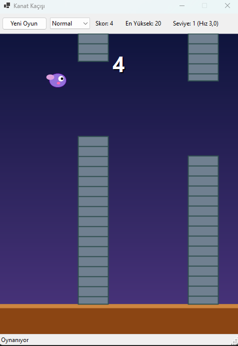

# Kanat Kaçışı

Zıplayan bir karakterle engeller arasından geçilen basit bir masaüstü oyunu (C# / Windows Forms). Taslak, geliştirme sürüyor.

## Kullanılan Teknolojiler

- C# / .NET 10 / Windows Forms

## Kurulum ve Çalıştırma

```
dotnet run --project KanatKacisi/KanatKacisi.csproj
```

## Temel Özellikler

_Hazırlanıyor._

## Ekran Görüntüleri




## Bilinen Sınırlamalar / Geliştirme Notları

_Hazırlanıyor._

## Öğrenci

Mahmut Başcı, 205542016
