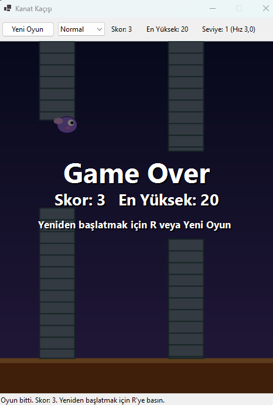

# Kanat Kaçışı

Mor, yuvarlak ve kanatlı bir yaratık olan **Pırpır**'ı klavyeyle zıplatıp taş sütunların arasındaki boşluklardan geçirdiğiniz basit bir masaüstü oyunu. YMH 219 Nesne Tabanlı Programlama dersinin "zıplayan karakterle engel geçme" türündeki masaüstü oyunu ödevi için C# / Windows Forms ile yazıldı. Oyunun adı, karakteri ve çizimleri bu projeye özgüdür. Tüm görseller kodla (`Graphics`) çizilir, görsel ya da ses dosyası kullanılmaz.

## Kullanılan Teknolojiler

- C# / .NET 10 (`net10.0-windows`), SDK 10.0.401
- Windows Forms (Microsoft.WindowsDesktop.App 10.0.12)
- NuGet paketi kullanılmadı.

## Kurulum ve Çalıştırma

**Gereksinim:** .NET 10 SDK; tasarımcı için Visual Studio 2026 veya `dotnet run`.

```
git clone https://github.com/mah0cb/YMH219-FlappyBird.git
cd YMH219-FlappyBird
```

**Visual Studio ile:** `YMH219-FlappyBird.sln` dosyasını açın ve F5 ile çalıştırın.

**Komut satırı / VS Code ile:**

```
dotnet run --project KanatKacisi/KanatKacisi.csproj
```

**Kontroller**

| Tuş | İşlev |
|-----|-------|
| Space / Yukarı ok | Zıpla (ilk basış oyunu başlatır) |
| R | Yeniden başlat |
| Yeni Oyun butonu | Yeniden başlat |
| Zorluk kutusu | Kolay / Normal / Zor (değiştirince yeni oyun başlar) |

## Temel Özellikler

- Yer çekimi ve zıplama fiziği (`Oyuncu` sınıfı).
- Sağdan sola kayan 3 sütun çifti. Ekrandan çıkan sütun en sağa yeniden konumlanır ve boşluk yüksekliği rastgele seçilir (`Engel` sınıfı).
- Sütuna, zemine veya tavana çarpınca oyun durur ve "Game Over" ekranı gösterilir. Çarpışma `Rectangle.IntersectsWith` ile kontrol edilir.
- Her geçilen sütun skoru 1 artırır.
- Her 5 skorda seviye ve hız artar (+0,5, en çok 7).
- Kolay / Normal / Zor seçimi boşluk boyutunu ve başlangıç hızını belirler.
- En yüksek skor `%AppData%\KanatKacisi\enyuksek.txt` dosyasında saklanır. Dosya hatalarında uygulama kapanmaz, durum çubuğunda Türkçe mesaj gösterilir.
- Çift tamponlu panel (`OyunPaneli`) sayesinde titremeden çizim yapılır. Oyun döngüsü 16 ms aralıklı `System.Windows.Forms.Timer` ile çalışır.

**Sınıf yapısı**

```
KanatKacisi/
  Models/    Oyuncu, Engel, OyunDurumu (Hazir/Oynaniyor/Bitti), Zorluk
  Services/  OyunMotoru (kurallar, skor, hız, çarpışma, OyunBitti olayı)
             EnYuksekSkorDeposu (dosyaya okuma/yazma)
  OyunPaneli.cs   DoubleBuffered Panel
  AnaForm.cs      Sadece arayüz: çizim, tuşlar, etiketler
```

## Ekran Görüntüleri

Oyun sırasında:


Game Over ekranı:



## Bilinen Sınırlamalar / Geliştirme Notları

- En yüksek skor tüm zorluk seviyeleri için tektir; zorluğa göre ayrı tutulmaz.
- Oyun hızı kare başına sabittir (Timer 16 ms). Yavaş bir bilgisayarda Timer gecikirse oyun biraz yavaşlar.
- Ses efekti ve duraklatma (pause) yoktur.
- Art arda iki boşluk arasındaki yükseklik farkı en çok 180 piksel olacak şekilde sınırlandı; böylece hız arttığında da geçiş mümkün kalır.
- Pencere boyutu sabittir. Oyun 480×600 birimlik bir alanda hesaplanır ve panel boyutuna ölçeklenerek çizilir.

## Öğrenci

Mahmut Başcı, 205542016
